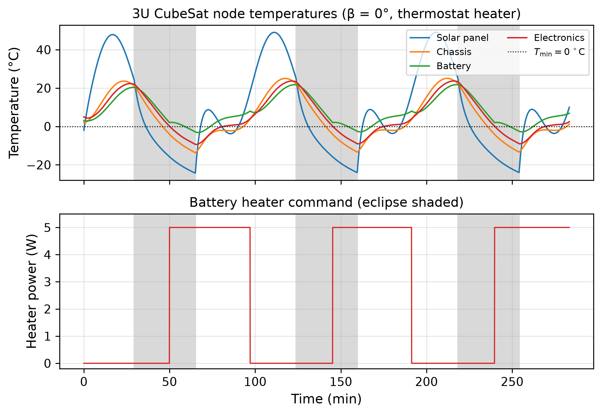
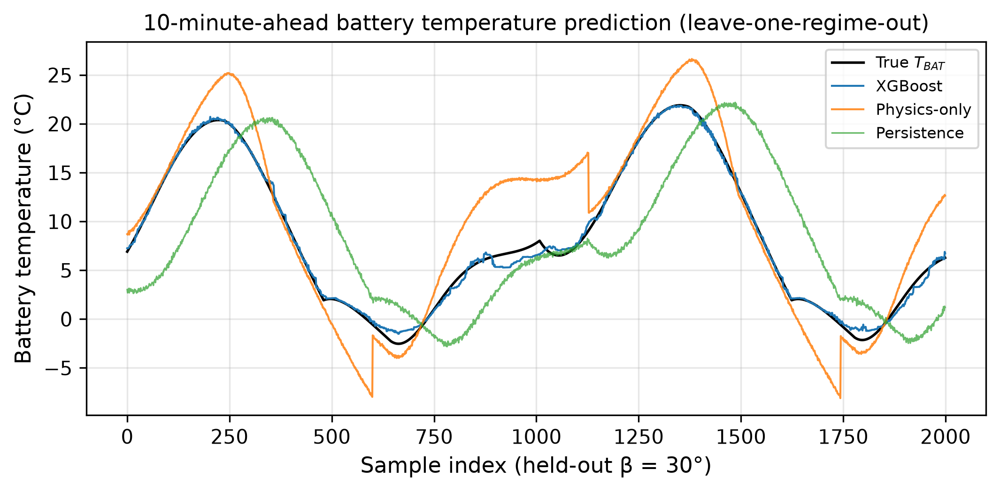
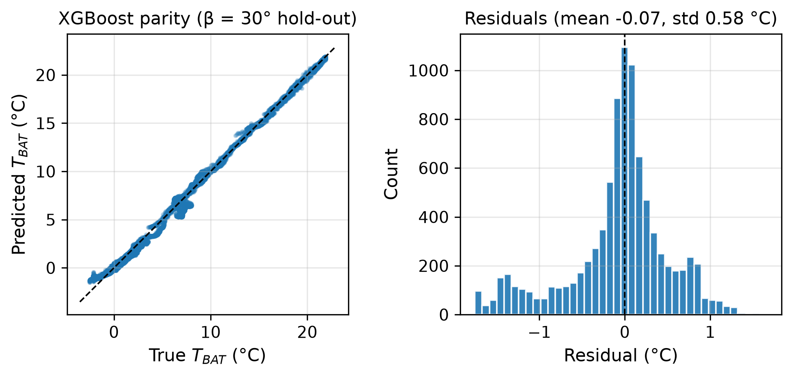
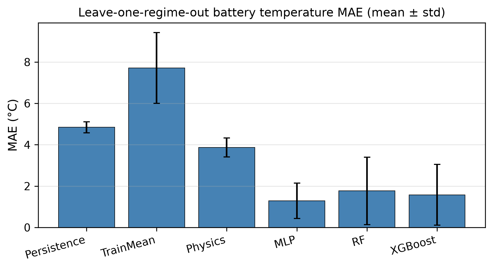
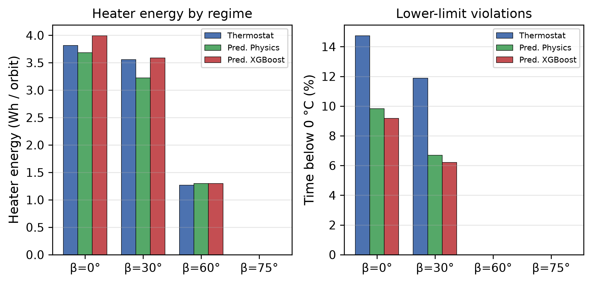
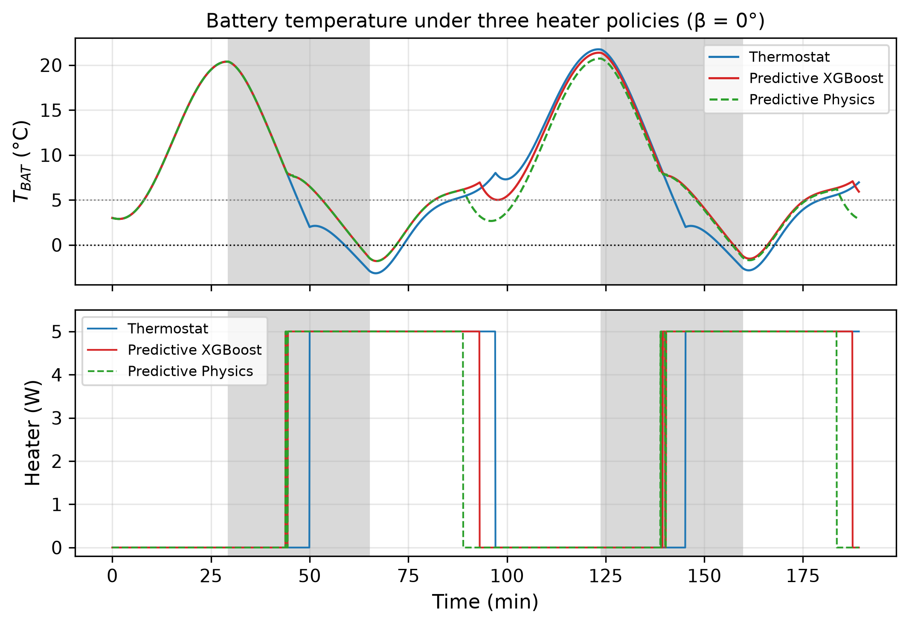

# A Hybrid Physics and Machine-Learning Approach to CubeSat Temperature Prediction and Heater Control

**Deepak P. S., Alan Vincent, Sankar Dev, and Jihad Haneefa Kassim**

*Author affiliations and corresponding-author details to be added.*

## Abstract

CubeSat batteries in low Earth orbit (LEO) must stay within a narrow temperature window while heater power competes with the rest of the electrical power system. This paper asks whether a standard four-node lumped-parameter thermal model of a 3U CubeSat, combined with lightweight machine-learning (ML) predictors, can forecast battery temperature accurately enough to improve on a simple hysteresis thermostat in simulation. We generate multi-orbit trajectories at four beta angles (0°, 30°, 60°, 75°) with a truth model that includes attitude-dependent solar view factors, albedo modulation and perturbed conductances; a nominal physics predictor intentionally omits those effects. Under leave-one-regime-out validation and a 10-minute horizon, a small multilayer perceptron (MLP, 1217 parameters) achieved mean MAE 1.29 ± 0.86 °C, ahead of XGBoost (1.58 ± 1.47 °C), Random Forest (1.77 ± 1.63 °C), the nominal physics model (3.87 ± 0.46 °C) and a persistence baseline (4.84 ± 0.27 °C). A predictive heater that uses the XGBoost forecast reduced the fraction of time below 0 °C from 6.65% (thermostat) to 3.85% at nearly the same heater energy (2.22 vs 2.16 Wh/orbit); a physics-based predictive policy cut violations to 4.13% while using slightly less energy (2.05 Wh/orbit). All results are simulation-only: they do not demonstrate on-orbit performance.

**Keywords:** CubeSat, thermal control, lumped-parameter model, battery heater, XGBoost, lightweight machine learning, leave-one-regime-out.

## 1. Introduction

Nanosatellites in LEO experience rapid sun–eclipse cycling. With small thermal mass, battery and electronics temperatures can move by tens of degrees within an orbit, and lithium-ion cells are typically restricted to roughly 0–45 °C for charging, with a preferred band near 10–35 °C [1], [2]. Active heaters are common, but heater energy reduces the power available to the payload, so controllers that heat only when necessary are attractive.

Flight software often uses a thermostat with hysteresis: the heater turns on below a low set-point and off above a high set-point [3]. A predictive policy that looks several minutes ahead could pre-heat before a deep eclipse or stay off when a short cold period is expected. That idea needs a temperature forecast that is accurate under orbital conditions not seen in training, small enough for an onboard computer, and honest about errors.

This paper studies a fully specified, reproducible simulation case rather than claiming a new satellite thermal architecture. The contributions are: (i) a transparent 4-node LEO CubeSat thermal model with an explicit truth/nominal mismatch so that residual learning is meaningful; (ii) a leave-one-regime-out comparison of persistence, nominal physics, Random Forest (RF), XGBoost and a deliberately small MLP for 10-minute battery-temperature prediction; and (iii) a head-to-head comparison of thermostat, physics-predictive and ML-predictive battery heaters on heater energy and time below 0 °C. We do not claim flight readiness, cooling-system design, or novelty of hybrid physics–ML thermal methods in general—those already appear in the spacecraft literature [4], [5]. The aim is a lightweight, auditable benchmark on a public-physics CubeSat case.

## 2. Related Work

**Lumped CubeSat thermal models.** Control-oriented lumped ODE models have been proposed for CubeSats when low dimension matters more than spatial detail [6]. Integrated thermal–electrical CubeSat battery simulations likewise adopt nodal energy balances with conduction and radiation [7]. Reviews of small-satellite thermal analysis summarise environmental fluxes, nodal networks and the limits of early-design tools relative to full finite-element models [8]. Nanosatellite LEO thermal design studies similarly emphasise passive coatings plus battery heaters for cold cases [9].

**Battery thermal limits and heaters.** COTS Li-ion modules for satellites are commonly operated between about 0 °C and 45 °C for charging, with broader discharge limits and a preferred 10–35 °C band [1]. CubeSat battery reviews emphasise heater use in eclipse and the sensitivity of resistance and lifetime to temperature [2]. SmallSat studies have designed low-cost battery heaters with thermostat set-points near room temperature for specific missions [3].

**ML and physics-informed thermal prediction.** Physics-informed neural networks have been used to estimate temperature fields on small-satellite thermal mathematical models from sparse sensors [4], and physics-informed learning has been applied to in-orbit thermal state estimation [5]. Classical neural predictors have also been trained for on-orbit instrument temperatures [10]. Those works motivate combining physics structure with data; the present study instead emphasises tiny tabular models (RF, XGBoost, a 1217-parameter MLP) and a closed-loop heater comparison on a transparent 4-node case.

## 3. Methods

### 3.1 Orbit and environment

We consider a circular LEO at 500 km altitude (orbital period 5668 s ≈ 94.5 min). Eclipse fraction follows cylindrical Earth-shadow geometry and decreases with beta angle β: 0.378 (0°), 0.358 (30°), 0.231 (60°) and 0 (75°, no eclipse). Environmental constants follow standard LEO design practice [11], [12]: solar constant 1367 W/m², Earth albedo factor 0.30 (nominal), Earth IR flux 237 W/m², and Stefan–Boltzmann constant σ = 5.670374419×10⁻⁸ W/m²/K⁴.

### 3.2 Four-node thermal model

Nodes are solar panel/outer structure (SP), chassis (CH), battery (BAT) and electronics (EL). For node *i*,

*C_i dT_i/dt = Q_{ext,i} + Q_{int,i} + Q_{heater,i} + Σ_j G_{ij}(T_j − T_i) − ε_i A_{rad,i} σ (T_i⁴ − T_space⁴)*,

with capacitances *C* ≈ [180, 450, 250, 150] J/K, nominal conductances of order 0.05–0.55 W/K, and optical properties in the range of typical external finishes (solar absorptivity and IR emissivity documented in code). Internal dissipation is duty-cycled (higher in sunlight for electronics and battery). A battery heater of at most 5 W acts only on the BAT node.

**Truth versus nominal.** The truth trajectory includes (a) an attitude-dependent solar view-factor multiplier between 0.55 and 1.0 in sunlight, (b) orbit-phase albedo modulation, and (c) off-diagonal conductance scales from 0.72× to 1.30× nominal. The physics predictor integrates the same ODE structure with fixed view factor (=1 in sun), constant albedo 0.30 and nominal *G*. Sensor noise of 0.15 °C std. is added to observed temperatures used by ML features and controllers. Integration uses RK4 with Δt = 5 s.

### 3.3 Datasets and regimes

For each β ∈ {0°, 30°, 60°, 75°} we simulate eight orbits under a hysteresis thermostat (T_on = 2 °C, T_off = 8 °C) to build supervised data, starting from a cold-biased initial state. Battery hard limits for scoring are T_min = 0 °C and T_max = 40 °C, consistent with conservative charge windows [1], [2].

### 3.4 Predictors

The target is true BAT temperature at horizon *H* = 600 s. Features at time *t* use only current and recent observations (no future leakage): node temperatures, BAT/EL rates, eclipse/sun flags, orbit-phase sine/cosine, estimated solar input from the nominal model, internal power estimates, heater command and recent mean, time-in-sun fraction over a short window, β, eclipse fraction, and short BAT history statistics (20 features). Models:

- **Persistence:** predict current observed BAT temperature.
- **Train-mean:** constant mean of training targets.
- **Physics:** open-loop nominal integration from the observed state, heater held at the current command.
- **RF:** 80 trees, max depth 12, min leaf 5.
- **XGBoost:** 200 trees, max depth 5, learning rate 0.05.
- **MLP:** StandardScaler + hidden layers 32 and 16 (1217 parameters), Adam, early stopping.

Hyperparameters were fixed a priori. Seeds were set to 0. An XGBoost ablation compares the full feature set with an eight-feature subset.

### 3.5 Controllers

- **Thermostat:** heater on below 2 °C, off above 8 °C.
- **Predictive XGBoost:** using the model trained with the current β held out; pre-heat if the heater-off forecast falls below 5 °C within *H*, or if the observation is already ≤ 2 °C; off above 8 °C; hard inhibit near T_max.
- **Predictive physics:** same logic with the nominal physics forecast.

Each controller is evaluated for six orbits at every β. Metrics: heater energy (Wh/orbit), fraction of time with T_BAT < 0 °C or > 40 °C, heater cycles, and temperature extremes.

### 3.6 Validation

Leave-one-regime-out: train on three β angles, test on the held-out β. Prediction metrics are MAE, RMSE, MaxAE and R² (°C). We report mean ± std across the four folds. Model size (serialized) and single-sample CPU latency are recorded.

## 4. Results

### 4.1 Temperature prediction

**Table 1.** Leave-one-regime-out 10-minute BAT prediction (mean over four held-out β angles).

| Model | MAE (°C) | RMSE (°C) | MaxAE (°C) | R² |
|---|---|---|---|---|
| Train-mean baseline | 7.71 ± 1.71 | 8.57 | 14.83 | −1.53 |
| Persistence | 4.84 ± 0.27 | 5.66 | 10.81 | 0.12 |
| Physics (nominal) | 3.87 ± 0.46 | 4.74 | 9.16 | 0.30 |
| Random Forest | 1.77 ± 1.63 | 2.32 | 5.98 | 0.64 |
| XGBoost | 1.58 ± 1.47 | 2.05 | 5.58 | 0.72 |
| **MLP (1217 params)** | **1.29 ± 0.86** | **1.66** | 5.13 | **0.86** |

On the cold, long-eclipse folds (β = 0° and 30°), XGBoost was best (MAE 0.52 °C and 0.41 °C). The MLP led the mean because it degraded less on β = 60° and especially on the no-eclipse fold β = 75° (MLP MAE 2.50 °C vs XGBoost 3.57 °C and RF 3.94 °C), where tree ensembles trained on eclipsing orbits extrapolate poorly. Physics beat persistence on every fold but lost to all three ML models on average once the 10-minute horizon let the truth/nominal mismatch accumulate. Reducing XGBoost to eight features raised mean error (e.g. MAE 0.66 °C vs 0.52 °C on β = 0°; much larger gaps on β = 75°).

Serialized sizes were about 38 kB (MLP), 0.74 MB (XGBoost) and 17–19 MB (RF). Median single-sample CPU latency was about 0.55 ms (MLP), 0.80 ms (XGBoost) and 12.7 ms (RF) on the evaluation machine.

### 4.2 Heater control

**Table 2.** Heater control over four β regimes (mean).

| Controller | Energy (Wh/orbit) | Time below 0 °C (%) | Heater cycles / run | Mean T_BAT,min (°C) |
|---|---|---|---|---|
| Thermostat | 2.16 ± 1.84 | 6.65 ± 7.77 | 4.5 | −0.43 |
| Predictive physics | 2.05 ± 1.71 | 4.13 ± 4.93 | 18.5 | 0.73 |
| Predictive XGBoost | 2.22 ± 1.90 | 3.85 ± 4.60 | 18.0 | 0.73 |

No controller exceeded 40 °C. At β = 0°, the thermostat spent 14.7% of time below 0 °C (3.82 Wh/orbit); predictive XGBoost cut that to 9.2% (3.99 Wh/orbit) and predictive physics to 9.8% (3.68 Wh/orbit). At β = 75° (no eclipse) no heater was needed. Predictive policies issued more on/off cycles than the thermostat, which is a cost for relay wear even when energy is similar.

## 5. Discussion

A 1–2 °C mean absolute error on a 10-minute battery forecast is small relative to the 0–40 °C operating window, but worst-case errors of 5–9 °C still matter near the lower limit: a controller that trusts the mean error alone can undershoot. The leave-one-regime-out design makes that clear—tree ensembles that look excellent on β = 0°/30° lose several degrees when asked to generalise to a non-eclipsing orbit.

Predictive heating traded a small energy change for fewer cold violations and a higher minimum battery temperature, at the price of more switching. In this simulated case the physics-predictive policy was competitive with ML on violations and slightly better on energy, which is expected when the nominal model is still a useful prior and the ML model is asked to extrapolate across orbital regimes. ML remains valuable as a residual corrector when the mismatch is large and in-regime data are available (β = 0°/30°).

**Limits.** Results are simulation-only. Optical properties, capacitances and conductances are literature-typical orders of magnitude, not a correlated flight model. Attitude is a stylised view-factor modulation, not a full quaternion truth. Controllers observe noisy temperatures and perfect eclipse knowledge; real ADCS/EPS interfaces are messier. Energy figures refer only to the battery heater, not the full EPS budget. Hybrid physics–ML thermal estimation is not new [4], [5]; this paper’s role is a lightweight, fully open comparison on a small LEO case.

## 6. Conclusion

On a transparent 4-node 3U CubeSat LEO simulation with intentional model mismatch, lightweight predictors reduced 10-minute battery-temperature MAE from 4.84 °C (persistence) and 3.87 °C (nominal physics) to 1.29 °C (small MLP) under leave-one-regime-out evaluation. Predictive heater policies roughly halved cold-limit exposure relative to a late-reacting thermostat at similar heater energy in the same simulation. The study supports further work on regime-aware training and residual physics–ML predictors; it does not by itself establish flight performance.

## References

[1] M. Eilenberger, H. Gunasekar, D. Gomez Toro, and C. Bänsch, "Analysis of the thermal design of a COTS-based modular battery system for satellites by thermal vacuum testing," *CEAS Space Journal*, 2023, doi:10.1007/s12567-023-00526-8.

[2] V. Knap, L. K. Vestergaard, and D.-I. Stroe, "A review of battery technology in CubeSats and small satellite solutions," *Energies*, vol. 13, no. 16, Art. no. 4097, 2020, doi:10.3390/en13164097.

[3] O. Nesbit, S. Whilden, and D. R. Mishra, "Developing a full system thermal analysis of a CubeSat to design a low-cost battery heater system," in *Proc. AIAA/USU Conf. on Small Satellites (SmallSat)*, 2025. Available: https://digitalcommons.usu.edu/smallsat/

[4] H. Tanaka, K. Fujita, and H. Nagai, "Evaluation of temperature estimation accuracy using Physics-Informed Neural Network for small satellite model," *51st Int. Conf. on Environmental Systems (ICES-2022-161)*, St. Paul, MN, 2022.

[5] H. Tanaka and H. Nagai, "Data-driven thermal state estimation for in-orbit systems via physics-informed machine learning," *Acta Astronautica*, vol. 212, pp. 316–328, 2023, doi:10.1016/j.actaastro.2023.07.039.

[6] N. Al Hemeary, M. Jaworski, J. Kindracki, and G. Szederkényi, "Thermal model development for a CubeSat," *Hungarian Journal of Industry and Chemistry*, vol. 47, no. 1, pp. 25–32, 2019, doi:10.33927/hjic-2019-05.

[7] S. Vega Martínez, E. Morsch Filho, L. O. Seman, E. A. Bezerra, V. de Paulo Nicolau, R. García Ovejero, and V. R. Q. Leithardt, "An integrated thermal-electrical model for simulations of battery behavior in CubeSats," *Applied Sciences*, vol. 11, no. 4, Art. no. 1554, 2021, doi:10.3390/app11041554.

[8] M. Shen, L. Zhang, Z. Sun, L. Kong, Y. Liu, and Z. Xue, "Models, simulations, and applications of small satellite thermal analysis," *Advances in Space Research*, vol. 74, no. 2, pp. 836–860, 2024, doi:10.1016/j.asr.2024.04.026.

[9] S. Corpino, M. Caldera, F. Nichele, M. C. Masoero, and N. Viola, "Thermal design and analysis of a nanosatellite in low earth orbit," *Acta Astronautica*, vol. 115, pp. 247–261, 2015, doi:10.1016/j.actaastro.2015.05.012.

[10] F. Yang, Q. Sun, and L. Cheng, "BP neural network for temperature prediction of Alpha Magnetic Spectrometer on orbit," *J. Phys.: Conf. Ser.*, vol. 1824, Art. no. 012004, 2021, doi:10.1088/1742-6596/1824/1/012004.

[11] D. G. Gilmore, Ed., *Spacecraft Thermal Control Handbook, Volume I: Fundamental Technologies*. El Segundo, CA: The Aerospace Press, 2002.

[12] NASA Preferred Reliability Practices, "Earth orbit environmental heating," Practice No. PD-ED-1204 (solar constant and LEO heating guidance).
